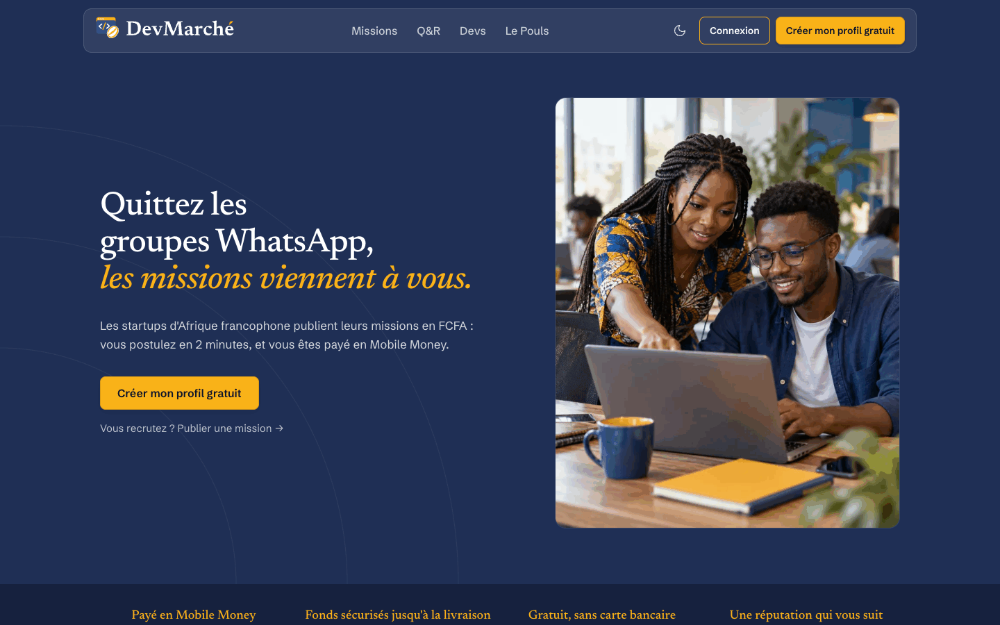
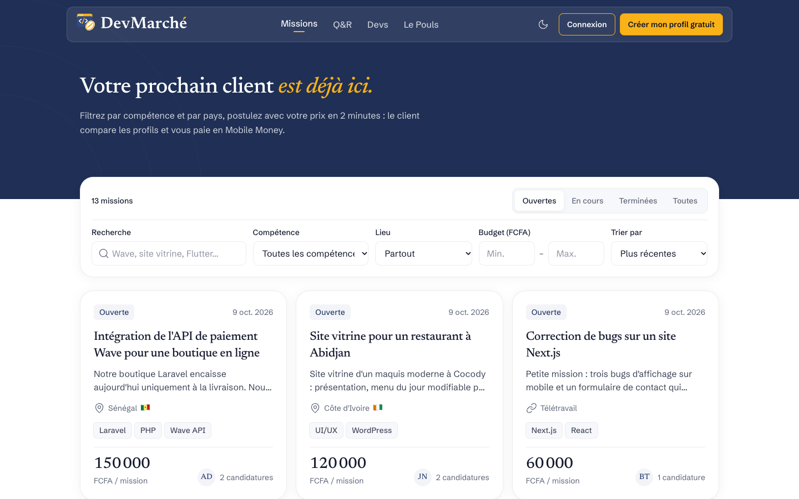
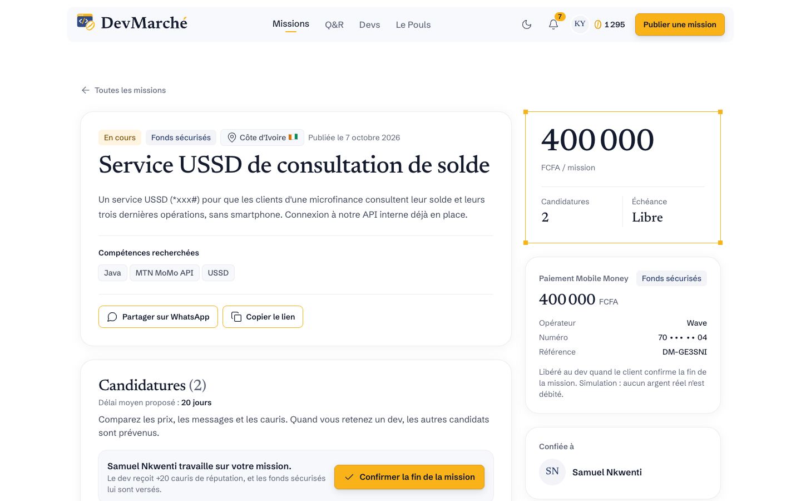
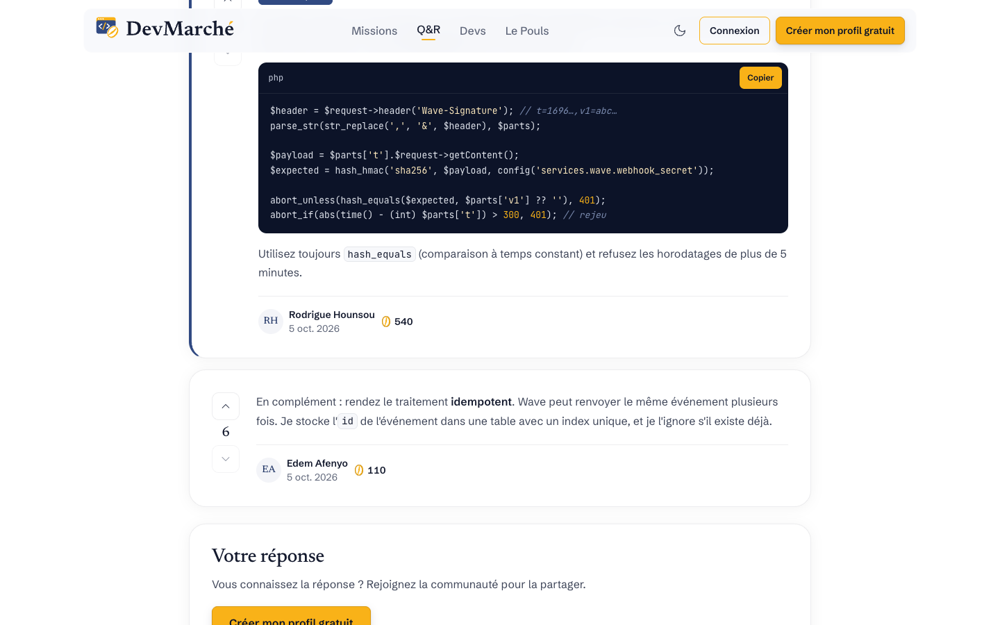
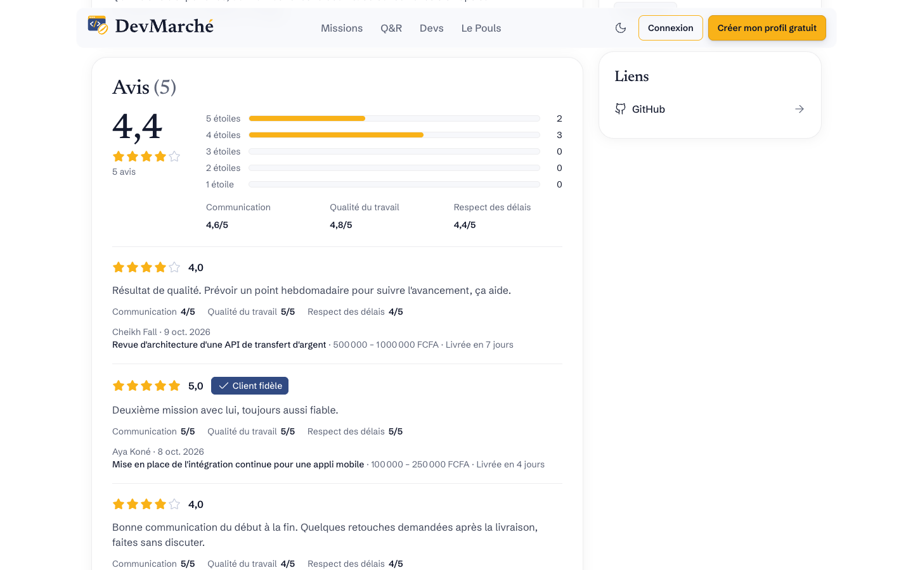
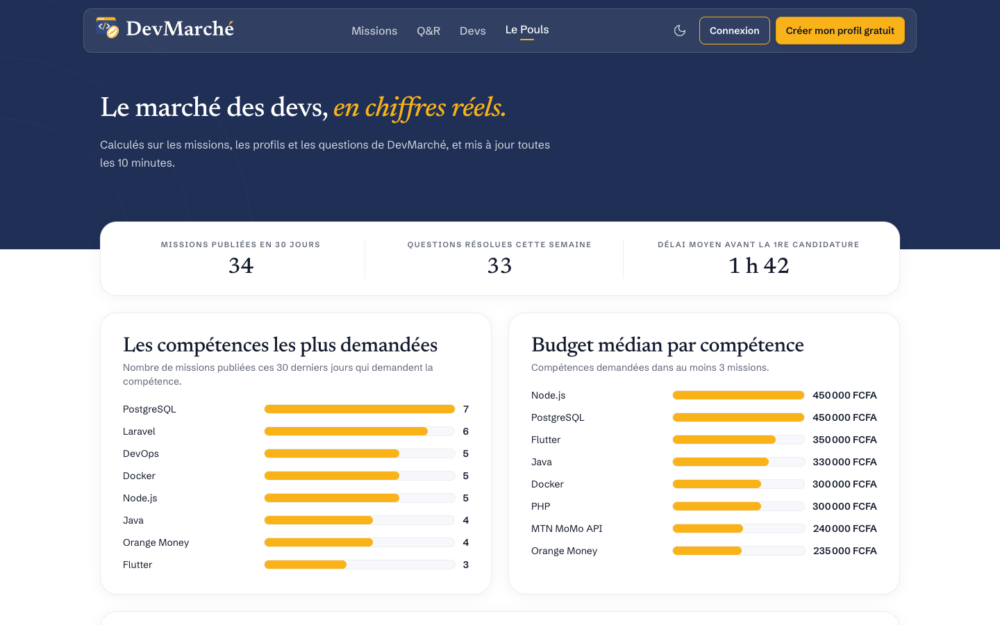
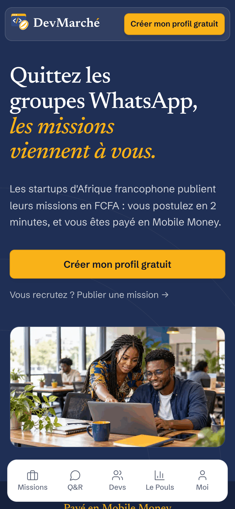
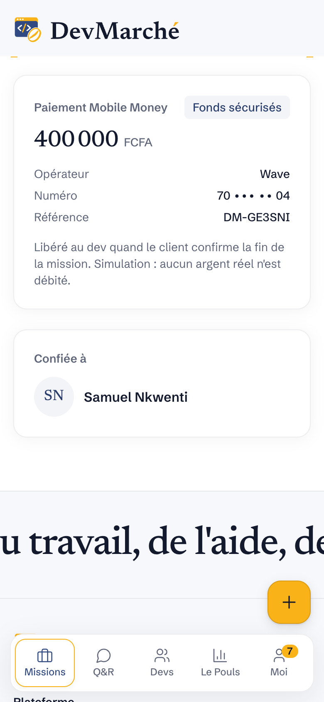
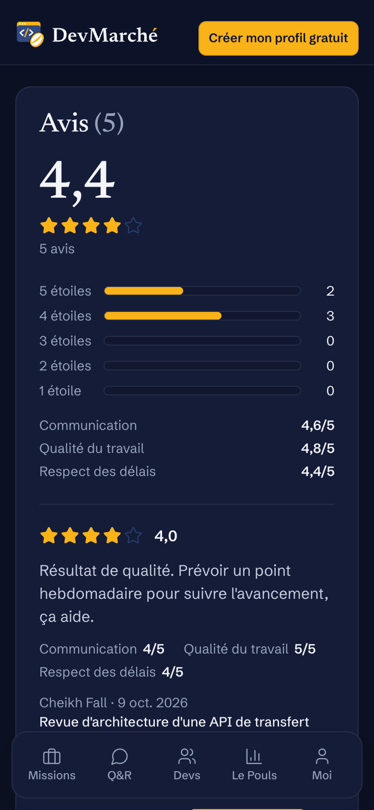
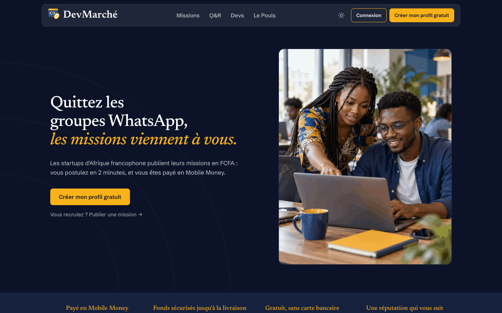

# DevMarché

**La plateforme d'échange des développeurs d'Afrique francophone : des missions payées en FCFA, des questions-réponses en français et un annuaire de devs, sur une seule plateforme pensée pour la 3G et le Mobile Money.**

Démo en ligne : *à compléter (déploiement sur Systalink Datacloud, Dakar)*

Projet de l'équipe **Baobab Stack** (Sénégal), concours CADEV 2026 organisé par Systalink.

---

## Captures

| Accueil | Missions | Fiche mission, fonds sécurisés |
|---|---|---|
|  |  |  |

| Question avec code | Profil et avis | Le Pouls |
|---|---|---|
|  |  |  |

Sur mobile (390 × 844) et en thème sombre :

| Accueil | Fiche mission | Profil (sombre) | Accueil (sombre, ordinateur) |
|---|---|---|---|
|  |  |  |  |

Toutes les captures sont dans [`docs/captures/`](docs/captures/).

## Fonctionnalités

**Missions**
- Publication d'une mission avec un budget en FCFA, un pays ou le télétravail, des compétences ; estimation du budget médian des missions comparables pendant la saisie.
- Liste filtrable : recherche plein texte en français, compétence, catégorie, pays, budget, statut.
- Candidature avec un prix et un délai ; le client compare les profils, les cauris, les niveaux et les avis.
- Paiement Mobile Money simulé avec séquestre : le client sécurise les fonds (Wave, Orange Money, Free Money, MTN MoMo, Moov Money) avec un code de confirmation simulé ; les fonds sont versés au dev à la fin de la mission, remboursés en cas d'annulation. Aucun argent réel, aucun service externe.
- Avis du client après la mission : note globale et 3 critères (communication, qualité, délais).

**Questions-réponses**
- Questions et réponses en Markdown, avec coloration du code côté serveur et bouton « Copier ».
- Votes, réponse acceptée, recherche plein texte en français, filtres par tag et par statut.

**Profils et réputation**
- Profil public : compétences, ville, langues parlées, disponibilité, dernière activité.
- Réputation en cauris (missions terminées, réponses utiles, avis), niveaux (Nouveau, Confirmé, Expert, Référence).
- Annuaire filtrable par compétence, pays, ville, disponibilité, niveau et langue.

**Communauté**
- Notifications dans l'application (candidatures, décisions, fin de mission, avis, réponses).
- Le Pouls : statistiques réelles du marché (compétences demandées, budget médian, devs par pays).
- Signalement des contenus et file de modération.
- Partage WhatsApp et copie du lien sur les fiches.

**Spécial démo**
- Connexion en un clic avec trois comptes (startup, dev, modérateur), bandeau du mode démo, données réinitialisées chaque nuit sur les 30 derniers jours.

## Stack

| Couche | Choix |
|---|---|
| Langage | PHP 8.2 |
| Framework | Laravel 12, Fortify (authentification) |
| Interactivité | Livewire 3 et Alpine.js |
| Base de données | PostgreSQL 16 (recherche plein texte en français, index GIN) |
| Styles | Tailwind CSS 4, thème clair et sombre |
| Markdown | league/commonmark, scrivo/highlight.php |
| Images | Intervention Image (avatars en WebP) |
| Tests | Pest 3 |
| Hébergement | Nginx, PHP-FPM, Ubuntu 24.04, Systalink Datacloud (Dakar) |

## Architecture

```
Navigateur (HTML rendu par le serveur, Livewire et Alpine pour l'interactivité)
        │  HTTPS
        ▼
Nginx ── fichiers statiques (build Vite fingerprinté, polices, images)
        │  FastCGI
        ▼
Laravel 12 (PHP-FPM)
  ├── Routes web ─ Contrôleurs ─ Form Requests (validation) ─ Policies (autorisation)
  ├── Composants Livewire (filtres, votes, aperçu Markdown, estimateur de budget)
  ├── Services métier : MissionService, PaymentService, ReviewService, AnswerService,
  │                     VoteService, ReputationService, PulseService
  ├── Notifications (canal base de données)
  └── Planificateur (demo:reset chaque nuit à 3 h)
        │
        ▼
PostgreSQL 16 : users, profiles, skills, missions, applications, payments, reviews,
                questions, answers, votes, reputation_events, notifications, reports
```

Le détail : [documentation/03-architecture.md](documentation/03-architecture.md) et [documentation/04-modele-donnees.md](documentation/04-modele-donnees.md).

## Installation locale

Prérequis : PHP 8.2 (extensions pgsql, mbstring, intl, gd), Composer, Node.js 20 ou plus, PostgreSQL 16.

```bash
git clone <URL_DU_DEPOT> devmarche && cd devmarche
composer install
npm install

cp .env.example .env
php artisan key:generate
```

Dans `.env`, renseignez la base (`DB_DATABASE=devmarche`, `DB_USERNAME`, `DB_PASSWORD`), puis :

```bash
createdb devmarche
php artisan migrate --seed        # schéma et données de démonstration
php artisan storage:link          # avatars
npm run build                     # CSS et JS
php artisan serve                 # http://127.0.0.1:8000
```

Pour la connexion en un clic, mettez `APP_DEMO=true` dans `.env`.

### Comptes de démonstration

Mot de passe commun : `password`.

| Rôle | E-mail |
|---|---|
| Startup (Aïssatou, Dakar) | `aissatou@demo.devmarche.test` |
| Dev (Moussa, Thiès) | `moussa@demo.devmarche.test` |
| Modération | `moderation@demo.devmarche.test` |

## Tests

```bash
createdb devmarche_test && createdb devmarche_demo_test
php artisan test
```

365 tests (Pest), environ 25 secondes. Les tests du jeu de démonstration complet (`tests/Demo`) utilisent une base semée une seule fois par lancement.

## Déploiement

Guide pas à pas, fichiers Nginx, PHP-FPM et systemd, script `deploy/deploy.sh` : [documentation/12-deploiement.md](documentation/12-deploiement.md).

Sécurité, accessibilité et performance : [documentation/13-securite.md](documentation/13-securite.md).

## Licences

Toutes les dépendances sont sous licence permissive (MIT, BSD, ISC, SIL OFL). Le tableau complet, généré depuis `composer.lock` et `package-lock.json`, est sur la page **À propos** du site (`/a-propos`).

## Usage de l'intelligence artificielle

- Claude Code (Anthropic) : conception, documentation, code, tests et revue de code.
- Générateur d'images IA : image d'illustration de l'accueil.

## Équipe

**Baobab Stack** (Sénégal) : Yaya Niang (représentant), Aminata Sall.
